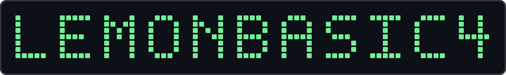

<div align="center">


### Lemonbasic4 · Developer · Building things that work
</div>

---

## `$ whoami`

Aspiring full-stack developer focused on practical web applications, information systems. I enjoy turning real-world workflows into useful software.

```javascript
const lemonbasic4 = {
  username: "Justine",
  focus: ["Full-stack development", "Information systems", "Automation"],
  building: ["Raquel Pawnshop HR Workforce Analytics & Evaluation Platform", "Business applications"],
  philosophy: "Build. Learn. Improve."
};
```

---

## `$ ls -la ~/projects`

<details>
<summary>🗂️ <b>Information Systems</b></summary>
<br>

- **HR Unified Talent Record System** — centralized employee records, evaluations, career movement, and workforce analytics (capstone).
- **Gym Management System** — deployed management application.

</details>

<details>
<summary>🌐 <b>Web Applications</b></summary>
<br>

- **Cafe & Resto POS** — small-business ordering and sales workflow project.
- **Student Project Search Engine** — searchable PHP/MySQL project directory.

</details>

<details>
<summary>⚙️ <b>Automation & Experiments</b></summary>
<br>

- **COFR Facebook Automation Suite** — user interface project.
- **AI-assisted workflows** — experiments with n8n, Google Sheets, and Gemini.

</details>

---

## `$ cat tech-stack.json`

```json
{
  "languages": ["JavaScript", "PHP", "Python", "SQL"],
  "web": ["HTML", "CSS"],
  "databases": ["MySQL"],
  "tools": ["Git", "GitHub", "VS Code", "XAMPP", "n8n"]
}
```

---

## `$ git stats`

<div align="center">
  
  
</div>

---

<div align="center">

`$ echo "Keep building."`

</div>
"# lemonbasic4-sys" 
"# lemonbasic4-sys" 
